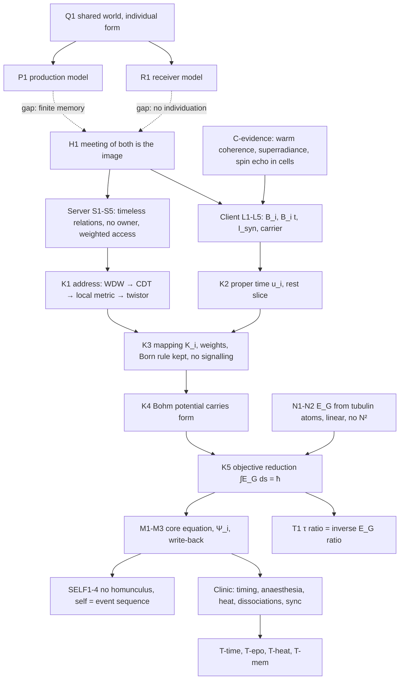

# Claim Graph: Consciousness as Interpretation

Core statements of the paper as nodes, their relations as edges. Each node links to the place in the source (`body_revised.tex`, `appendices_revised.tex`).
Edge words: **needs** (depends on), **answers** (resolves a gap), **tested by**, **fixes** (sets a quantity).
Scope: a paper on consciousness. The mapping from quantum physics onto gravitational physics is worked out for this one locally bounded special case only; no claim of a general theory of quantum gravity. See also [TLDR.md](TLDR.md).

## Backbone

## Objection index

| Reflex objection | Answered at |
|---|---|
| Homunculus / Cartesian theatre | SELF1, SELF2, CON5, S4 |
| Decoherence in warm, wet brain (Tegmark-type) | C-evidence, A-mt; table [app L56-L86](appendices_revised.tex#L56-L86) |
| Claims a theory of quantum gravity | Scope line above; K1 uses only local geometry |
| `E_G` needs hidden N² amplification or fitted collapse time | N1, N2, CON3 |
| Weighting breaks Born rule or allows signalling | K3 consistency lemma [app L368-L435](appendices_revised.tex#L368-L435) |
| Where does time come from in a timeless field | S3 (Page-Wootters), K2 |
| Receiver models have no channel or rule | R1.gap1 → S1, K1, K3 |
| If Orch OR (or `E_G`, AdEx, microtubules) fails, the model fails / modularity makes it unfalsifiable | CON-mod: each is a replaceable module; architecture-level failure conditions named |
| Untestable | T1, T-time, T-epo, T-heat, T-mem, CON4 |
| Free parameters everywhere | OPEN1 names the one open form (`W_i`); direction fixed by B1 data |
| Diósi-Penrose collapse is already excluded experimentally | XC15: those bounds apply to universal noise models, not to this branch calculation |
| "Coherence" in App. D means quantum coherence | XD2: there it is relational (pattern) coherence `η` |

## 1. The question

- **Q1** Every person experiences a shared world in an individual form. A model of consciousness must explain how the shared world gets this individual form. [L31-L36](body_revised.tex#L31-L36)
- **P1** Production model: everything needed stays inside the body (covers GNW, IIT, predictive processing as one boundary). [L40-L56](body_revised.tex#L40-L56)
- **P1.gap1** Local memory is finite and changes; a relation missing from input and history has no route into experience. [L58-L61](body_revised.tex#L58-L61)
- **P1.gap2** The step from processing to one situated image is only named ("the brain produces it"), not described. [L61-L63](body_revised.tex#L61-L63)
- **R1** Receiver model (James 1898): the basis lies outside, the brain receives or filters. [L65-L69](body_revised.tex#L65-L69)
- **R1.gap1** A receiver needs something transmissible, a channel, and a rule linking source to organism. [L69-L72](body_revised.tex#L69-L72)
- **R1.gap2** Received content has no biography, position or moment; reception moves individuation without explaining it. [L74-L78](body_revised.tex#L74-L78)
- **H1** Hypothesis: the wider basis holds relations without a viewpoint, the body contributes history, state and position; neither is conscious alone, and their meeting is the conscious image. A collaboration, not a compromise. [L80-L91](body_revised.tex#L80-L91)
  - answers P1.gap1 (relations come from the wider basis), R1.gap2 (individuation comes from the body)
  - needs: a client (→ ch. 3), a relational basis (→ ch. 4), a connection (→ ch. 5)

## 2. The local client

- **L1** Lifetime structure `B_i`: the slowly changing configuration left by development, memory, language, habits. Two people render related data differently because `B_i ≠_K B_j`. [L107-L113](body_revised.tex#L107-L113) → formal: App. C, operational individuality [app L437-L452](appendices_revised.tex#L437-L452)
  - answers R1.gap2 (biography)
- **L2** Present state `B_i(t)`: attention, fatigue, medication, body state; changes over ms to hours without replacing `B_i`. Separates temporary disturbance from structural loss. [L115-L119](body_revised.tex#L115-L119)
  - used by: clinical chapter (anaesthesia, heat)
- **L3** Sensory and bodily input `I_syn(t)` anchors source, position and event. `D_local = {carrier, B_i, B_i(t), I_syn(t)}`. [L121-L127](body_revised.tex#L121-L127)
  - answers R1.gap2 (position, moment)
- **L4** Local memory is finite and reconstructive: Hopfield limit about 0.14 patterns per unit, so a finite network has a finite critical load. Memory gives data a familiar place and viewpoint, not a full archive. [L135-L150](body_revised.tex#L135-L150) → [app L867-L876](appendices_revised.tex#L867-L876)
  - supports P1.gap1 with a number
  - tested by T-L4: at first contact, measure prior exposure, genotype, endocrine state, familiarity and response together. [L152-L155](body_revised.tex#L152-L155)
- **L5** Physical carrier, three levels: microtubule coherence (enters objective reduction), adaptive membrane dynamics (AdEx), recurrent neural fields (Wilson-Cowan). [L159-L170](body_revised.tex#L159-L170)
  - needs C-evidence
- **C-evidence** Why microtubules, four requirements each with its hurdle (collective motion vs heat, joining vs size, warm coherence, matching time window): Froehlich pump threshold; Froehlich-type condensation at 300 K (Preto 2026); domain coupling (Diaz-Palencia 2025); warm coherence (Engel 2007 ff.); spin echo inside living cells, coherence time near 1 µs (Ishiwata 2026); superradiance in tryptophan/tubulin (Babcock 2024); QED-cavity decoherence 1e-7 to 1e-6 s (Mavromatos 2025). [L172-L215](body_revised.tex#L172-L215) → table [app L56-L86](appendices_revised.tex#L56-L86)
  - answers the coherence objection
- **L6** The local side explains ownership and state dependence; relations beyond local encoding need a second data side. [L217-L220](body_revised.tex#L217-L220)
  - leads to S1

## 3. The server

- **S1** Timeless relational field `φ_Q`: a shared basis of relations (correlations and entanglement, network `Γ_server`), not a second finished consciousness. Called a server because it holds relations a client can meet. [L225-L233](body_revised.tex#L225-L233)
  - answers P1.gap1 (relations beyond local storage), R1.gap1 (what is "transmissible": relations, not experience)
  - formal: Wheeler-DeWitt state, correlation map `e_γ = Tr(ρ_Q C_γ)` [app L133-L151](appendices_revised.tex#L133-L151)
- **S2** Accumulation without overwriting: a realised event leaves a relation that later mappings can meet; read and write are described from inside a local history, no server clock. [L237-L244](body_revised.tex#L237-L244) → [app L152-L186](appendices_revised.tex#L152-L186)
  - needs S3
- **S3** Timelessness: the field holds relations, not a sequence; before and after appear only in a local history. Basis: Page-Wootters (a static universe with internally ordered observers); what holds for the universe also holds in the small, for cold atoms in a bottle of laser light (Barontini 2026). [L246-L255](body_revised.tex#L246-L255)
  - answers: many life histories without a master clock
- **S4** No owner: no biography, viewpoint or body; a shared relation `γ_ij` becomes something different for each person; ownership and perspective arise in the local mapping. [L257-L263](body_revised.tex#L257-L263)
  - needs L1 (perspective comes from the client) → foundation of the homunculus answer
- **S5** Weighted access, no personal areas: relation strength times current mappability, favouring nearness to the event, biography and the image in progress; weak links stay possible. Gives `Γ_i^(n)`. [L265-L274](body_revised.tex#L265-L274) → weighting rule and monotonicity bounds [app L278-L322](appendices_revised.tex#L278-L322)
  - needs L1, L2
- **S6** Neither side is a conscious image yet; a process in local time must meet a basis with no time or viewpoint. [L276-L280](body_revised.tex#L276-L280)
  - leads to ch. 5

## 4. The connection

- **K1** Address: Wheeler-DeWitt (whole universe, no external clock) → CDT, of which only the smooth geometry at cell scale is used → local frame, spinors → twistor address, only in the practically flat neighbourhood of the event. [L293-L309](body_revised.tex#L293-L309) → [app L188-L276](appendices_revised.tex#L188-L276)
  - needs S1, S3
  - this is the coupling of the timeless state to ordinary (locally Einsteinian) spacetime
- **K2** Time direction comes from the client: proper time `u_i` orders before and after and defines the spatial rest slice on which gravity, and later `E_G`, is evaluated. [L311-L317](body_revised.tex#L311-L317) → [app L226-L261](appendices_revised.tex#L226-L261)
  - answers S3 (where order comes from), needs L5 (a body with a worldline)
- **K3** Mapping `K_i` at the address: compares relations with `B_i`, `B_i(t)`, `I_syn(t)` and any gap `G_i`; weight = strength × uptake; biological hardware limits the result to realisable branches. [L319-L326](body_revised.tex#L319-L326) → branch set, coefficients [app L324-L366](appendices_revised.tex#L324-L366)
  - needs K1, K2, S5, L1-L3
  - consistency lemma: the weighting is a completely positive instrument, Born rule unchanged, no signalling between clients [app L368-L435](appendices_revised.tex#L368-L435)
- **K4** Layer 1, before decision: Bohm's quantum potential carries the form of the branches; scale-invariant, adds no energy, chooses nothing. [L330-L338](body_revised.tex#L330-L338) → [app L465-L494](appendices_revised.tex#L465-L494)
- **K5** Layer 2, decision: objective reduction (Orch OR). Metabolic energy drives a microtubule vibration; above threshold it recruits neighbouring regions; each region raises `E_G`; when `∫E_G ds ~ ħ`, one state is fixed. Neurons and networks carry it into the next configuration and into the shared structure. [L340-L356](body_revised.tex#L340-L356) → recruitment and trigger [app L590-L656](appendices_revised.tex#L590-L656)
  - needs K3, L5, C-evidence; fixes the event; closes S2 (write-back)
- **K6** Each reduction closes one mapping cycle; matches discrete perception (Wiest and Puniani 2025). [L370-L373](body_revised.tex#L370-L373)
- **N1** `E_G` from atomic coordinates of tubulin (1JFF), 13 protofilaments, no assumed collapse time; finite dimer counts for 25 and 500 ms; `N* = ħ/(τ e_G)`, so 20× shorter window needs 20× more dimers. [L375-L382](body_revised.tex#L375-L382) → [app L658-L811](appendices_revised.tex#L658-L811)
- **N2** `E_G` grows almost exactly linearly with dimer count; cross terms negligible, bounded even for very long microtubules; no hidden N² amplification. Comes from geometry, not built in. Historical Hameroff-Penrose values only for comparison. [L384-L393](body_revised.tex#L384-L393) → lemma, deviation < 7.6e-15 up to 3.4 M dimers [app L750-L787](appendices_revised.tex#L750-L787)
  - needs N1
- **T1** Ratio test: `τ_b/τ_a = E_G,a / E_G,b` for two independently characterised carrier states; twice the `E_G`, half the time. [L395-L404](body_revised.tex#L395-L404)
  - tests K5, N1, N2 (physical side)

## 5. Complete model and self

- **M1** Core equation: `Ψ_i = K_i(D_local, D_server, G_i | u_i)`, `∫₀^τ E_G ds = ħ`, constant `E_G` → `τ = ħ/E_G`. [L413-L430](body_revised.tex#L413-L430)
  - assembles L3, S1, K2, K3, K5
- **M2** `G_i` empty in continuous perception; after disturbance holds the unresolved part of the local sequence. [L443-L446](body_revised.tex#L443-L446) → App. E [app L1040-L1068](appendices_revised.tex#L1040-L1068)
- **M3** `Ψ_i` = the experiential image formed and lived in one event (vision, sound, body, thought, memory, emotion). After realisation it updates `B_i` and adds a relation to the client's ordered history, reachable by later cycles. Cycle: read → map → inscribe. [L456-L463](body_revised.tex#L456-L463), figure [L465-L500](body_revised.tex#L465-L500)
  - closes S2, K5
- **SELF1** Forming the image is experiencing it; perspective arises in the forming, not in later viewing. No inner viewer needed; the model does not forbid a homunculus, it has no work left for one. [L505-L510](body_revised.tex#L505-L510)
  - needs M3, S4; = homunculus answer
- **SELF2** The self is the ordered sequence of events, each inheriting the configuration of the one before; perspective is made new each event, not held by a standing observer. [L510-L513](body_revised.tex#L510-L513)
  - needs SELF1, L1
- **SELF3** Ego belongs to `B_i` (learned biographical form); `K_i` is the active process. Unconsciousness interrupts rendering, structure stays → continuity rebuilt. Structural degeneration changes the available self-model. [L515-L519](body_revised.tex#L515-L519)
  - needs L1, L2; used by clinical chapter
- **SELF4** A relation can be shared, perspective stays with the local sequence. [L521-L526](body_revised.tex#L521-L526)
  - needs S4
- **B1** Benchmark for the weighting direction: closed event structures complete patterns more strongly than open chains at equal relation count (Horner 2015); semantic and causal centrality predict recall, hippocampal recruitment and cross-participant convergence (Lee and Chen 2022). Fixes direction of `W_i` independently of the model. [L528-L537](body_revised.tex#L528-L537) → [app L878-L993](appendices_revised.tex#L878-L993)
  - supports S5; tested by T-mem (preregistered protocol)

## 6. Clinical perturbations

- **A-time** Timing: conscious placement follows earlier processing over a measurable interval (Libet). Olfaction separates early registration from conscious identification; three studies give 325-400 ms between early and late responses (Harada 2003: 350; Kayser 2010: 325; Walla 2002: 400, later window stronger with awareness). [L556-L575](body_revised.tex#L556-L575)
  - AdEx: one spike-triggered increment of `w_i` delays the next trigger, computed over full `I/I_rheo` range. [L577-L591](body_revised.tex#L577-L591) → [app L995-L1038](appendices_revised.tex#L995-L1038)
  - carrier scaling via N1/N2. [L593-L601](body_revised.tex#L593-L601)
  - **T-time**: record early registration, conscious report, neural state and odour familiarity in the same participants → tests range, adaptation and carrier scaling together. [L603-L606](body_revised.tex#L603-L606)
  - needs K5, K6, L5
- **A-anaes** Anaesthesia splits by mechanism. Dissociative (ketamine): `I_syn` loses dominance, `K_i` stays active → vivid, biographical experience, weak body anchor. Suppressive (propofol): stable coupling stops, no image fixed. Neighbours: REM sleep, deep coma. [L610-L618](body_revised.tex#L610-L618)
  - needs L3, K3, K5
- **A-mt** Microtubule link: anaesthetic potency ↔ tubulin oscillations (Craddock 2017); energy migration in microtubules damped by isoflurane and etomidate (Kalra 2023); microtubule drugs shift isoflurane sensitivity in mice (Li 2025); epothilone B delays loss of responsiveness (Khan 2024 rats, 69 s, d=1.9; Huang 2026 mice, 29 s, d=0.8). In the model a carrier change shifts the transition where stable rendering is lost. [L620-L631](body_revised.tex#L620-L631)
  - supports L5, K5; **T-epo**: size of delay should follow measured carrier change (see conclusion)
- **A-heat** Heat as stage-resolved test without removing input. Field study (Cedeño-Laurent 2018, 44 students): about 13 % slower Stroop and arithmetic at 26.3 °C vs 21.4 °C, optimum near 22 °C. Passive heating: brain temperature up, perfusion, motor activity and Stroop accuracy down (Tan 2024). EEG: early N100 stable, later P300 earlier and smaller; cooling restores (Shibasaki 2016, Nakata 2021). [L635-L653](body_revised.tex#L635-L653)
  - needs L2 (state), separates early registration (L3) from later processing (K3)
  - table: brain +0.9 °C; N100 unchanged; P300 latency −3 % auditory, −7 to −9 % visual; P300 amplitude −16 to −32 %; reaction time −9 %, Stroop accuracy lower. [L656-L700](body_revised.tex#L656-L700)
- **A-heat2** Heat does not slow the brain overall: evaluation finishes earlier, its response is smaller (warmer neurons: faster Na inactivation, shorter spikes; Yu 2012). In the model heat changes `B_i(t)` and the realisable branch set → a quicker answer from a weaker mapping; speed and integrity move in opposite directions. [L702-L709](body_revised.tex#L702-L709)
  - **T-heat**: speed and integrity stay opposed while early registration stays intact.
- **A-heat3** Second, independent carrier test: microtubule shear modulus depends on temperature (Kis 2008); recruitment and trigger equations turn the measured carrier change into a change of reduction interval. Record brain temperature, carrier state, P300 and accuracy together → separates the two timescales. [L711-L718](body_revised.tex#L711-L718)
  - links A-heat to T1, N1
- **D0** Clinical value: conditions that look alike from outside come from different disturbances inside the cycle (no stable image / no link to identity / not kept as memory / present but not expressed). Question changes from "is consciousness present" to "where is the mapping disturbed, what still works". [L727-L735](body_revised.tex#L727-L735)
  - needs M3, SELF3; table of dissociations follows
- **D-table** (operation → dissociation):
  - temporal integration → akinetopsia, palinopsia [L749-L752](body_revised.tex#L749-L752)
  - current recruitment → absence seizure (response fails, short-term storage stays) [L753-L756](body_revised.tex#L753-L756)
  - form-to-identity → associative agnosia, prosopagnosia [L757-L760](body_revised.tex#L757-L760)
  - familiarity weighting → Capgras (identity recognised, familiarity assigned to another source) [L761-L765](body_revised.tex#L761-L765)
  - durable write → anterograde amnesia (H.M.) [L766-L769](body_revised.tex#L766-L769)
  - behavioural expression → UWS, MCS, akinetic mutism (covert command following remains) [L770-L773](body_revised.tex#L770-L773)
- **OP0** Controlled disruption gives a pattern more useful than one awake-to-unconscious scale; functions fail and return separately. [L784-L790](body_revised.tex#L784-L790)
- **OP1** Named operations: WRITE (durable memory into `B_i`), INTERPRET/FILL (completion of content in `K_i`), ANCHORING (to body and environment via `B_i(t)`, `I_syn`), REBOOT/SYNC (staged recovery across `G_i`), OPERATION PROFILE (agent × dose). [L792-L796](body_revised.tex#L792-L796)
- **OP2** Sync: body and senses return but the present no longer joins the last stable state; the interval is `G_i`. The interpreter maps body, history and server relations back onto senses, position and local time order. Weak or contradictory anchors → coherent experience with wrong source, viewpoint or time. [L798-L814](body_revised.tex#L798-L814) → App. E
  - needs M2, K3
- **OP-table** (operation → evidence):
  - WRITE → midazolam; isolated forearm: 12 of 260 responded under anaesthesia, none recalled (Sanders 2017) [L828-L831](body_revised.tex#L828-L831)
  - FILL → Charles Bonnet: images form without visual input, early visual cortex active before report [L832-L835](body_revised.tex#L832-L835)
  - ANCHORING → ketamine, rubber hand: vivid experience, unstable ownership and location [L836-L839](body_revised.tex#L836-L839)
  - SYNC → emergence after 3 h isoflurane: frontoparietal dynamics return before responsiveness, ordered recovery (Mashour 2021) [L840-L843](body_revised.tex#L840-L843)
  - PROFILE → operations do not fail together or equally [L844-L847](body_revised.tex#L844-L847)

## 7. Conclusion

- **CON1** Answer to Q1: the field carries relations without a viewpoint, the living system carries the history through which a viewpoint forms; meeting in `K_i` → branches → physical fixation → inscription. [L858-L863](body_revised.tex#L858-L863)
  - answers Q1 via H1
- **CON2** Each application touches a different point of the cycle; for medicine: ask where the mapping is disturbed and what still works. [L865-L872](body_revised.tex#L865-L872)
  - summarises A-time, A-anaes, A-heat, D0, OP0
- **CON3** Numbers not borrowed: `E_G` from tubulin coordinates, uncalibrated, near-linear, 1e9 to 1e12 dimers for 25 to 500 ms. [L874-L880](body_revised.tex#L874-L880)
  - = N1, N2
- **CON4** Tests with existing methods: T1 (ratio), T-epo (delay follows carrier change), T-heat (speed vs integrity), T-mem (relational structure before recall predicts convergence). Entering state measured first, consequence derived before comparison with report. [L882-L894](body_revised.tex#L882-L894)
- **CON-mod** Modular: the architecture is the meeting (history, relational field, one mapping); carrier (microtubules, 3.3), coarse geometry (CDT, K1), form layer (Bohm, K4), reduction (Orch OR, K5) and neuron model (AdEx, A-time) are replaceable realisations, each with the property a substitute must keep. T1 and T-epo test the mechanism (fail → replace mechanism); "replaced, and the model stays"; the model fails only if T-mem shows no convergence or everything met for the first time can be explained by what was already learned (T-L4). [L896-L904](body_revised.tex#L896-L904)
- **OPEN1** Exact form of `W_i` open, only direction of dependencies fixed; recruitment treated as simple onset. [L906-L909](body_revised.tex#L906-L909)
- **OPEN2** The field is not observed directly; the tests decide, not a look at the server. [L909-L911](body_revised.tex#L909-L911)
- **CON5** World and observer appear together in the meeting; the observer is part of what is formed, so no homunculus watches it. [L913-L917](body_revised.tex#L913-L917)
  - = SELF1

## 8. Appendices

### A. Notation
- **XA** One table of all symbols. [app L1-L52](appendices_revised.tex#L1-L52)

### B. Neurodynamic and biological implementation
- **XB1** Carrier source table: Froehlich, pump threshold, Preto 2026 (condensation at 300 K), Engel/Panitchayangkoon/Collini (warm coherence), Ishiwata 2026 (spin echo in living cells, T2 about 1 µs), Babcock 2024 (superradiance), Mavromatos 2025 (decoherence 1e-7 to 1e-6 s), Craddock 2017, Kalra 2023, Khan 2024, Li 2025, Huang 2026. [app L56-L86](appendices_revised.tex#L56-L86)
  - = C-evidence, A-mt with numbers
- **XB2** Wilson-Cowan population field; drive `P` includes the realised-carrier input. [app L88-L103](appendices_revised.tex#L88-L103)
- **XB3** AdEx neuron; effective trigger current depends on adaptation `w_i`; time = proper time `s_i`. [app L105-L127](appendices_revised.tex#L105-L127)
  - links L5 to K2

### C. Quantum-gravitational coupling and derivations
- **XC1** Server: `H|Φ> = 0`; `e_γ = Tr(ρ_Q C_γ)`; local read via projector `Π_i`; write-back `B_i ⊕ Ψ_i`; global `ρ_Q` has no `n` evolution (Page-Wootters). [app L133-L186](appendices_revised.tex#L133-L186)
  - formalises S1-S3
- **XC2** CDT partition sum → coarse-grained Lorentzian metric at `ℓ ≫ a_CDT` → tetrad and spin frame → `u_i` (normalised proper time) → rest slice `h_i` → Green kernel, Newtonian `1/r` in the local flat limit. [app L188-L261](appendices_revised.tex#L188-L261)
  - formalises K1, K2; this is the WDW-to-Einstein-spacetime link
- **XC3** Twistor incidence only in the flat tangent space at the event; no global twistor transport. [app L263-L276](appendices_revised.tex#L263-L276)
- **XC4** Weights `ω = e · m`, `m = W_i(distance, proper-time gap, biographical affinity, pattern overlap, G_i; B_i, B_i(t), I_syn, H_i)`; only invariants; monotonicity bounds (affinity and overlap up, distance and time gap down). [app L278-L322](appendices_revised.tex#L278-L322)
  - formalises S5; open form = OPEN1
- **XC5** Branch state and weighted coefficients, normalised. [app L324-L366](appendices_revised.tex#L324-L366)
- **XC6** Consistency lemma: weighting = completely positive two-outcome instrument; Born rule applied unchanged afterwards (ω is not a second probability rule); uniform weights recover the standard state; no-signalling for spacelike separated settings. [app L368-L435](appendices_revised.tex#L368-L435)
  - answers "breaks quantum mechanics" objection
- **XC7** Operational individuality: `B_i ≠_K B_j` iff one input condition gives different mappings; one shared relation pattern, two different mapping cycles. [app L437-L463](appendices_revised.tex#L437-L463)
  - formalises L1, SELF4
- **XC8** Bohm quantum potential, pre-reduction only; scale-invariant; selects and reweights nothing; no Bohmian trajectory introduced. [app L465-L494](appendices_revised.tex#L465-L494)
  - formalises K4
- **XC9** Branch mass density on the CDT rest slice; Penrose `E_G` functional; Gaussian nuclear kernels; exact self terms, controlled cross-term expansion; Orch OR action condition, order-one factor set to 1; Born probabilities unchanged; Diósi noise not used. [app L496-L588](appendices_revised.tex#L496-L588)
  - formalises K5
- **XC10** Froehlich recruitment with gain, loss, redistribution and neighbour coupling; coupling redistributes the pump, adds no energy; onset threshold `r_c`; recruited set `Ω_i`; trigger when `A_i = (1/ħ)∫E_G ds ≥ 1`. Binary onset is an approximation, no fitted threshold. [app L590-L656](appendices_revised.tex#L590-L656)
  - formalises K5; open part = OPEN1 (simple onset)
- **XC11** Geometric `E_G`: 1JFF, 6,578 heavy atoms, 838/896 residues (corrected), 13 protofilaments, 8 nm spacing, no calibration. Two readings of the 2.5 fm profile bracket the result: `N*` from 1.9e9 to 5.8e10 at 500 ms and 3.7e10 to 1.2e12 at 25 ms. Totals across domains, not one cylinder length. [app L658-L709](appendices_revised.tex#L658-L709)
  - = N1, CON3
- **XC12** Historical Hameroff-Penrose anchors (1e9 at 500 ms, 2e10 at 25 ms) only for comparison. [app L711-L738](appendices_revised.tex#L711-L738)
- **XC13** Recruitment-reduction lemma: `E_G = e_G N (1+δ)`, `|δ| < 7.6e-15` up to 3,407,872 dimers; analytic tail bound 8.84e-69 J per dimer; no N² term as length grows; reduction depends on accumulated recruitment `∫N ds`, so different pump paths reach the same threshold. [app L750-L787](appendices_revised.tex#L750-L787)
  - = N2
- **XC14** Parameter provenance table for `E_G` and recruitment. [app L790-L813](appendices_revised.tex#L790-L813)
- **XC15** Stochastic collapse bounds (LISA Pathfinder, Gran Sasso, XENONnT) constrain universal Diósi-Penrose noise; their noise lengths are not inputs here. [app L815-L821](appendices_revised.tex#L815-L821)
  - answers "DP collapse is already excluded" objection
- **XC16** Full dependency chain from `H|Φ> = 0` to the next cycle's input in one equation. [app L823-L863](appendices_revised.tex#L823-L863)
  - = whole backbone K1 → M3

### D. Model tests and numerical results
- **XD1** Hopfield finite load `P_crit ≈ 0.14 N`. [app L867-L876](appendices_revised.tex#L867-L876)
  - = L4
- **XD2** Relational convergence: dominance `d`, relational coherence `η` (pattern coherence, not quantum coherence), convergence `C = d·η`; measured centrality from Lee and Chen; benchmark table (Horner 2015, Lee and Chen 2022); preregistered protocol and hypothesis: shared condition gives higher convergence, higher fidelity, shorter response time. [app L878-L993](appendices_revised.tex#L878-L993)
  - = B1, T-mem
- **XD3** AdEx rheobase 627.311 pA; adaptation tested over full drive sweep; integration step checked. [app L995-L1038](appendices_revised.tex#L995-L1038)
  - = A-time

### E. Mapping disruption and resynchronisation
- **XE1** Gap `G_i` between last stable and first recovered state; resync repeats the full cycle; `G_i` shrinks each cycle and is empty when sync completes; fidelity `F_i` of source, perspective, event, time. [app L1040-L1068](appendices_revised.tex#L1040-L1068)
  - = M2, OP2
